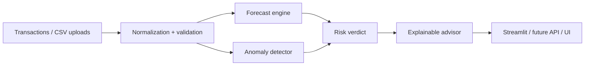

# Architecture

The current repo focuses on the core deterministic engine:
- ingestion and validation
- cash-flow forecasting and uncertainty bands
- affordability guardrails
- deterministic fallback explanations
- sample-data generation

The backend/frontend deployment layers remain future work and are intentionally documented as TODO in the progress file.
